---

### 👋 Olá, me chamo Leonardo Pinge!

Estudo Engenharia de Computação na UNIFEV (me formo no fim de 2026) e trabalho com PHP e MySQL na NKN Digital, mexendo num ERP que está em produção.

Fora do trabalho, faço sites e sistemas como freelancer e brinco bastante com IA: automações no n8n com LLMs, visão computacional com YOLO e algumas redes neurais que implementei na mão pra entender como funcionam. Meu TCC é o BoviCare, um brete automatizado pra gado com ESP32, RFID e Bluetooth.

---

### 🚀 Tecnologias & Ferramentas

---

### 📫 Vamos nos conectar!

---

<picture>
  <source media="(prefers-color-scheme: dark)" srcset="https://raw.githubusercontent.com/leopinge/leopinge/output/github-contribution-grid-snake-dark.svg">
  <source media="(prefers-color-scheme: light)" srcset="https://raw.githubusercontent.com/leopinge/leopinge/output/github-contribution-grid-snake.svg">
  
</picture>

